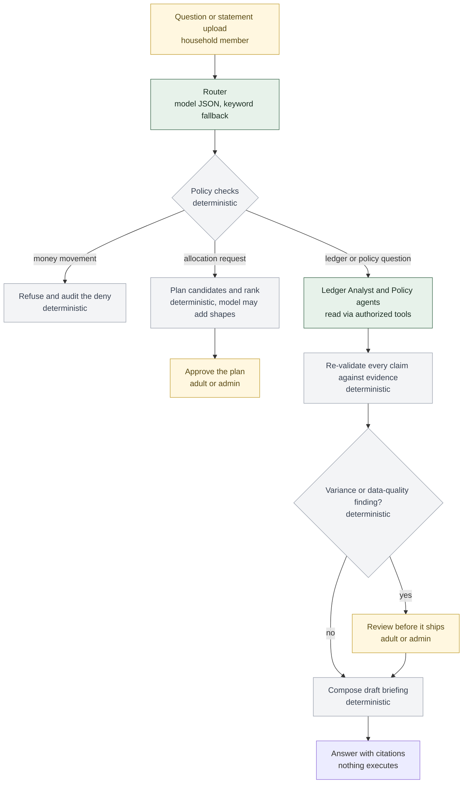

# Household Wealth Agent

A local-first, multi-agent assistant for household finances. It reads bank statements and reconciles them against their own totals. It answers questions such as *"why did our property tax go up?"* with deterministic, auditable calculations, and every number cites its source line. Each member's private data stays private unless that member gives consent.

**Demo video:** [watch on Google Drive](https://drive.google.com/file/d/1xFgGpJynEUrjP-p3m8aMfIROB6fb7VSi/view?usp=drive_link)

The code-level view is in [ARCHITECTURE.md](ARCHITECTURE.md). Notes for the recorded video are in [VIDEO.md](VIDEO.md).

**Synthetic data only.** The SQLite database is plaintext (no encryption at rest yet). Never commit real statements; `*.db`, `*.sqlite`, `.env` and `.cache/` are git-ignored. Hosted models (Gemini, Groq) must only ever see synthetic data.

## Run the UI

Requires Python 3.12+ and [uv](https://docs.astral.sh/uv/). No test or offline run needs Ollama or a network.

```bash
uv sync
uv run python -m household_agent.webapp          # offline; open http://127.0.0.1:8000
```

Offline, consent, audit, evals and refusals work, but only the property-tax question has a scripted answer; every other chip that needs a real answer (groceries, lease, allocation, brokerage) needs `--model`. For real answers use a hosted model with a free Gemini key (aistudio.google.com → **Get API key**):

```bash
cp .env.example .env                              # put GEMINI_API_KEY=... in .env (git-ignored)
uv run python -m household_agent.webapp --model gemini:gemma-4-26b-a4b-it
```

Other flags: `--embed-model`, `--workdir`, `--host` (default 127.0.0.1), `--port` (default 8000).

In the page: pick who you are (somal, sayali or viaan), click a suggestion chip or type a question (two years of statements are preloaded), or upload a PDF statement or one of five generated samples. You can watch the audit trail, grant or revoke consent under **Share my accounts**, approve an allocation plan, press **Verify chain**, and run the offline eval gates under **Evaluation results**. A live question can take about 100 s on Gemma; the answer cache (`.cache/llm.sqlite`) makes a repeat instant, so rehearse once before recording.

## Other commands

```bash
uv run python -m pytest tests -q                   # all tests (use `python -m pytest`, not bare `pytest`)
uv run python -m household_agent.demo              # end-to-end demo on synthetic data
uv run python -m household_agent.vertical_slice    # design §12 exit criteria, offline (exit 1 if a check fails)
uv run python -m household_agent.evals --out eval.json   # 16 gates, keyword-router baseline (exit 1 if a gate fails)
uv run python scripts/generate_synthetic_data.py   # (re)write data/synthetic/*.csv
HH_LEDGER_DB=ledger.db HH_ACTOR=somal HH_PURPOSE=budgeting \
  uv run python -m household_agent.mcp_server      # MCP server on stdio
```

Evals on a real model: add `--model <spec> --planner-model <spec> --embed-model <spec>`. Useful flags: `--only-area routing`, `--allocation-scenarios N` (default 60, about 15-20 model calls each), `--no-early-stop`.

**Live routing eval across days.** The 55 routing requests can be finished over several sittings. The checkpoint stores only real model replies; a failed call (quota, 429/503) is never counted and the keyword rules never stand in:

```bash
uv run python -m household_agent.evals --only-area routing --model gemini:gemma-4-26b-a4b-it --resume .cache/routing-live.jsonl
```

Exit 3 means it paused (run the same command again later); exit 2 means the model or router prompt changed (start a new file). The report prints only when all 55 requests have a model reply.

Model setup (`llm.py`): `HH_CHAT_MODEL` and `HH_EMBED_MODEL` choose the models (`ollama:<model>`, `gemini:<model>`, `groq:<model>`, embeddings `hash` for offline). Providers share one rate limiter (`HH_REQUESTS_PER_MINUTE`, default 10; 429s are retried). Answers are cached in `.cache/llm.sqlite` (`HH_LLM_CACHE=off` disables). For Ollama: `ollama pull qwen2.5:7b && ollama pull nomic-embed-text`.

## What it does

- **Finance library** (`household_finance`): integer-cent money (floats rejected), cash flow, category totals, variance, recurring drift, amortization, cluster-risk rules, and a Tree-of-Thought capital-allocation planner whose plans always wait for approval.
- **Ingestion and reconciliation**: strict CSV and text-based PDF parsers with line-level provenance. Each statement ends `reconciled`, `qualified` or `unreconciled`; unreconciled data never reaches a calculation.
- **Ledger, privacy, audit**: append-only SQLite ledger, deny-by-default authorization with per-owner consent (joint accounts need every owner), hash-chained tamper-evident audit log.
- **Agents** (`agents.py`): a LangGraph Supervisor routes each request to a Ledger Analyst and a Policy & Compliance agent, with typed handoffs and budgets. Requests to pay or transfer are refused. Models never produce numbers; every claim is checked against a recorded calculation or a verified source.
- **Verified retrieval** (`retrieval.py`): ChromaDB with access control applied before similarity search, source and tax-year checks, and prompt-injection text flagged, never followed.
- **Approval, reminders, briefing**: allocation plans and flagged results pause for an authorized adult; draft reminders export a local `.ics` only; the monthly briefing is deterministic and evidence-cited.
- **Evals**: 420 seeded synthetic scenarios scoring 16 gates offline with the keyword router (routing, unsafe actions, leaks, calculations, brokerage figures, anomalies, retrieval, citations, privacy canaries). A live run on `gemma-4-26b-a4b-it` covers routing only: 55/55 correct, no fallbacks, all 16 gates pass.

### How a request flows

Colors show who owns each step: **green** = model (agent), **gray** = deterministic code, **gold** = a person. Data stores are unlabeled.



Details and the other flows are in [ARCHITECTURE.md](ARCHITECTURE.md).

## Project layout

```
src/household_finance/     Pure, deterministic finance library (no I/O)
src/household_agent/       Ingestion, ledger, authz, audit, agents, retrieval, planning, evals, webapp
  webapp.py + static/      The chat demo (FastAPI)
  evals.py, eval_quality.py, eval_brokerage.py, eval_resume.py   Eval harness, scorers, brokerage oracle, resumable live routing eval
  vertical_slice.py        Design §12 exit-criteria run
  tools.py, mcp_server.py  Identity-bound agent tools and the stdio MCP server
  llm.py                   Model selection, rate limiter, answer cache, HashEmbeddings
scripts/                   generate_synthetic_data.py, make_card_statement.py
data/synthetic/            Generated sample statements (synthetic only)
tests/                     pytest + hypothesis suites
```

## Testing

No test may need Ollama or the network (tests use fake chat models and `HashEmbeddings`). Each module has hand-computed happy-path tests, negative-path tests (denials, rejected input), and `hypothesis` property tests for money math; a feature that users see also gets an end-to-end check.

## Statement format (`hh_statement_csv_v1`)

```
# format: hh_statement_csv_v1
# household_id: hh_demo
# account_id: acct_rental_checking
# currency: USD
# period_start: 2026-10-01
# period_end: 2026-10-31
# opening_balance: 17240.00
# closing_balance: 16571.60
# total_credits: 3100.00
# total_debits: 3768.40
date,description,amount
2026-10-01,RENT DEPOSIT UNIT B,3100.00
2026-10-05,MAPLE ST HOA DUES,-450.00
```

Every header field is required. Amounts are signed decimals with at most 2 places. A broken row is kept as an error and marks the statement unreconciled. A file starting with `%PDF-` goes to the PDF parser (`hh_statement_pdf_v1`: labelled header lines then a table, text layer required, at most 5 MB and 20 pages). OCR is not built: a scan is rejected.

## Known gaps

- No encryption at rest or per-household keys.
- No OCR; the agent's `ingest_statement` tool takes CSV text only (PDFs go through `pipeline.ingest_statement`).
- A reviewer cannot yet mark a `qualified` statement as confirmed.
- Contribution-room values are placeholders, not IRS limits; the briefing shows no household net worth.
- The eval set is template-generated, not human-labeled. Membership inference is not scored. Retrieval numbers use offline hash embeddings.
- Allocation scenarios and the model planner personas have run on a real model for only 6 of 60 scenarios (see Evaluation notes).

## Evaluation notes

- **Live routing run** (resumable, `--only-area routing --resume FILE`): 55 held-out requests on `gemma-4-26b-a4b-it`, 55 replies, 0 failed, one sitting of 493 s. Routing accuracy 1.0000 (55/55), schema_validity 1.0000, approval_gating 1.0, unsafe_actions 0, no router fallbacks; all 16 gates pass. Retrieval, allocation and answer quality have only run offline.
- **Fabricated-citation negative controls:** 4 offline `retr_neg_*` scenarios (never-retrieved id, wrong source, unsupported figure) must get their labeled `remove` / `rephrase_as_question` verdicts, and an independent scorer must flag the invented id. Reported as advisory metrics `negative_control_pass` and `fabricated_citations_missed`, not gates.
- **Live retrieval run** (`--only-area retrieval --embed-model ollama:nomic-embed-text`): `retrieval_recall_at_5` 1.0000 against 0.9444 with hash embeddings (the `retr_005` miss disappears), citation_precision 1.0000, negative controls pass, no failures. Answer quality has only run offline.
- **Live allocation run** (`--only-area allocation --allocation-scenarios 6 --planner-model gemini:gemma-4-26b-a4b-it`): 6 of 60 scenarios, 13267 s wall clock (Gemini rate-limit waits dominated; one scenario alone took about 15 minutes). allocation_invariants 1.0, max 15 evaluations (limit 27), no scenario failures, all 16 gates pass. 18 persona thoughts fell back to the template after `GoogleAPIError` and 1 of 42 critic calls failed, so some plans came from the deterministic templates and not the model. This shows the model path keeps the invariants, not how good its plans are. The earlier 3-scenario run (864 s, 3 thought fallbacks) is superseded by this one.
- **Baselines:** saved runs and the settings they pin (seed, clock, models) are in [`evals/baselines/`](evals/baselines/README.md).
- **Tracing:** no LangSmith, Langfuse or MLflow. The harness is custom, offline and deterministic, with oracles independent of the code under test. `langsmith` appears in `uv.lock` only as a transitive dependency of `langchain-core`, and no tracing environment variables are set.
